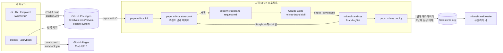

<p align="center">
  
</p>

<h1 align="center">밀버스 디자인 시스템</h1>

<p align="center">
  고객 브랜드를 Salesforce 화면 전체에 적용하고, 배포하기 전에 Storybook에서 확인하는 LWC 디자인 시스템입니다.
</p>

<p align="center">
  
  <a href="https://milvus-wina.github.io/milvus-design-system/"></a>
  
  <a href="LICENSE"></a>
</p>

<p align="center">
  <a href="https://milvus-wina.github.io/milvus-design-system/">문서 사이트</a> ·
  <a href="https://milvus-wina.github.io/milvus-design-system/?path=/docs/런북--docs">런북</a> ·
  <a href="https://github.com/Milvus-Wina/milvus-design-system">GitHub</a>
</p>

## 프로젝트 소개

패키지 `@milvus-wina/milvus-design-system`을 SFDX 프로젝트에 설치하고 `pnpm milvus init`을 실행하면 아래가 프로젝트에 들어옵니다.

- Salesforce에 없는 기능만 채우는 밀버스 LWC: Badge, MultiSelect, Notification, Calendar, 앱 전체 브랜드 로더
- 브랜드 파일: org 테마(BrandingSet), `milvusBrand.css`, `milvusBridge.css`, `milvusOverride.css`
- Salesforce 기본 컴포넌트(`lightning-*`) 73개를 내 브랜드로 그려 보는 Storybook 카탈로그와 브랜드 명세 페이지
- Claude Code 규칙: 디자인 규칙 문서, 브랜드 반영 skill, 권한 규칙, 스타일 검사 hook
- `pnpm milvus` CLI: `init`, `storybook`, `check`, `deploy`, `update`

브랜드 명세 페이지에 요청을 적고 Claude Code에 "브랜드 요청 반영해줘"라고 하면 브랜드 파일이 바뀝니다. Storybook에서 확인한 뒤 `pnpm milvus deploy`로 org에 배포합니다.

### 배경

같은 SLDS를 써도 프로젝트마다, LWC마다 화면이 달랐습니다. 고객 디자인을 컴포넌트 하나가 아니라 Salesforce 화면 전체에 적용하고, 배포하기 전에 Storybook에서 확인하려고 이 디자인 시스템을 만들었습니다.

### 원칙

1. **Salesforce 기본 컴포넌트를 먼저 씁니다.** 밀버스 컴포넌트는 기본 컴포넌트에 기능이 없을 때만 만듭니다.
2. **브랜드 색과 로고는 org 테마에서 바꿉니다.** 모양(모서리, 간격, 그림자 등)은 요청이 있을 때만 hook으로 바꿉니다.
3. **배포하기 전에 Storybook에서 확인합니다.**

## 목차

[시작하기](#시작하기) · [기술 스택](#기술-스택) · [화면 구성](#화면-구성) · [주요 기능](#주요-기능) · [아키텍처](#아키텍처) · [디렉터리 구조](#디렉터리-구조) · [더 보기](#더-보기) · [이 저장소에서 개발하기](#이-저장소에서-개발하기) · [라이선스](#라이선스) · [처음 만든 곳](#처음-만든-곳)

## 시작하기

여기서는 흐름만 적습니다. 토큰 만들기부터 배포 뒤 마무리까지는 문서 사이트의 [런북](https://milvus-wina.github.io/milvus-design-system/?path=/docs/런북--docs)을 따라 하세요.

### 요구 사항

| 항목                  | 조건                                                                                                                                                                                      |
| --------------------- | ----------------------------------------------------------------------------------------------------------------------------------------------------------------------------------------- |
| Node.js               | `^22.18.0 \|\| >=23.6.0` (22.18 이상, 23.x는 23.6 이상)                                                                                                                                   |
| pnpm                  | `npm`·`npx`·`yarn`은 쓰지 않습니다. pnpm 11이면 설치 전에 `pnpm-workspace.yaml`을 만듭니다(런북 2단계)                                                                                    |
| Salesforce CLI (`sf`) | `sf org login web --alias <별칭>`으로 org에 로그인해 둡니다                                                                                                                               |
| org                   | SLDS 2 테마 기준입니다. `--from-org`는 SLDS_v2 테마만 받습니다                                                                                                                            |
| GitHub 토큰           | GitHub Packages는 공개 패키지도 설치할 때 토큰이 필요합니다. classic 토큰에 `read:packages` 권한 하나만 주고 환경 변수 `NODE_AUTH_TOKEN`에 넣습니다. 토큰 줄은 사용자 `~/.npmrc`에 둡니다 |

### 설치와 실행

SFDX 프로젝트 폴더에서 실행합니다.

```bash
# 1. 레지스트리 줄을 프로젝트 .npmrc에 넣고 설치합니다
printf '@milvus-wina:registry=https://npm.pkg.github.com\n' >> .npmrc
pnpm add -D @milvus-wina/milvus-design-system

# 2. 규칙·컴포넌트·브랜드 파일을 놓습니다 (org의 지금 테마를 가져오려면 --brand 대신 --from-org)
pnpm milvus init --target-org <org 별칭> --brand <브랜드 이름>

# 3. 내 브랜드로 Storybook을 띄웁니다
pnpm milvus storybook
```

그다음 이렇게 진행합니다.

1. Storybook의 **시작하기 / 브랜드 명세**에 요청을 적고 저장합니다.
2. Claude Code에 "브랜드 요청 반영해줘"라고 합니다.
3. Storybook 툴바의 브랜드 메뉴에서 화면을 확인합니다.
4. `pnpm milvus deploy`로 배포 계획을 보고, 괜찮으면 `pnpm milvus deploy --yes`로 배포합니다.
5. org의 App Manager에서 유틸리티 바에 `milvusBrandLoader`를 넣고 "백그라운드로 로드"를 켭니다. Visualforce를 쓰면 Visualforce Settings의 SLDS 2 설정도 켭니다.

## 기술 스택

**Salesforce**


**문서·빌드**


**언어·런타임**


**품질 검사**


**배포·자동화**


## 화면 구성

[문서 사이트](https://milvus-wina.github.io/milvus-design-system/)는 이 저장소의 Storybook입니다. 고객 프로젝트에서 `pnpm milvus storybook`으로 띄우는 Storybook도 같은 메뉴를 쓰지만, 런북은 문서 사이트에만, 반영 검사는 고객 프로젝트에만 있습니다.

| 메뉴                            | 내용                                                                                                                                                 |
| ------------------------------- | ---------------------------------------------------------------------------------------------------------------------------------------------------- |
| 시작하기                        | 브랜드를 바꾸는 순서와 컴포넌트를 찾는 법                                                                                                            |
| 시작하기 / 브랜드 명세          | 브랜드 색, 로고, 피드백 색(성공·경고·오류·정보), 디자인 명세를 적고 저장합니다. 저장은 고객 프로젝트에서만 되고 문서 사이트에서는 막혀 있습니다      |
| 시작하기 / Salesforce 이용 약관 | "원본과 hook" 스토리가 보여 주는 Salesforce 원본 파일의 이용 약관 전문                                                                               |
| 시작하기 / 반영 검사            | 버튼을 누르면 스토리마다 기본 브랜드와 센티널 브랜드의 계산된 스타일을 비교해, 명세 항목별로 반영·빈틈·고정을 판정합니다. 고객 프로젝트에만 있습니다 |
| 런북                            | 준비부터 배포 뒤 마무리까지 따라 하기. 문서 사이트에만 있습니다                                                                                      |
| Foundations                     | 브랜드 스타일 (util.css), 컬러, 타이포그래피                                                                                                         |
| 컴포넌트 / 기본                 | Salesforce 기본 컴포넌트(`lightning-*`) 73개, 예제 249개. 컴포넌트마다 "원본과 hook" 스토리가 하나씩 더 있습니다                                     |
| 컴포넌트 / 밀버스 추가          | Badge, BrandLoader, Calendar, Modal, MultiSelect, Notification                                                                                       |

툴바의 **브랜드** 메뉴(붓 아이콘)에서 화면에 입힐 브랜드를 고릅니다. 문서 사이트에서는 `Milvus_DesignSystem`과 "샘플 브랜드 (org 아님)"(`brands/Sample_Forest`)를, 고객 프로젝트에서는 내 브랜드와 "SLDS 기본"을 고릅니다.

## 주요 기능

### `pnpm milvus` CLI

| 명령                                                                | 하는 일                                                                                                                                                                                                |
| ------------------------------------------------------------------- | ------------------------------------------------------------------------------------------------------------------------------------------------------------------------------------------------------ |
| `init --target-org <별칭> (--brand <이름> \| --from-org) [--no-vf]` | 프로젝트에 규칙·컴포넌트·브랜드 파일을 놓습니다. `--from-org`는 org의 활성 테마와 로고를 가져옵니다. 점검이나 조회가 하나라도 실패하면 아무것도 쓰지 않고, 이미 있는 파일은 덮어쓰지 않습니다          |
| `storybook [build]`                                                 | 프로젝트의 LWC와 SLDS 카탈로그를 빌드해 Storybook을 띄웁니다. dev 서버는 localhost에서만 엽니다. `build`는 `.milvus/storybook-static`에 정적 빌드합니다                                                |
| `check [--style]`                                                   | `milvusBrand.css`의 규칙과 대비, `milvusOverride.css`, BrandingSet의 `BRAND_COLOR`, 프로젝트 LWC의 모달 규칙을 검사합니다. `--style` 없이 실행하면 관리 파일이 바뀌지 않았는지도 sha256으로 확인합니다 |
| `deploy [--target-org <별칭>] [--yes]`                              | 전체 검사 뒤 배포 계획을 보여 줍니다. 1단계는 메타데이터를 한 번에 올리고(하나라도 실패하면 전부 롤백), 1단계가 성공했을 때만 2단계로 활성 테마를 바꿉니다                                             |
| `update [--force]`                                                  | 새 버전의 관리 파일로 바꿉니다. 로컬에서 고친 관리 파일이 있으면 아무것도 바꾸지 않고 차이를 보여 줍니다. `--force`는 덮어씁니다                                                                       |
| `--version`                                                         | 패키지 버전을 출력합니다                                                                                                                                                                               |

`deploy`는 `--target-org`가 없으면 `milvus.config.json`의 `targetOrg`를 쓰고, sf 기본 org는 쓰지 않습니다. `--yes`가 없으면 계획만 보여 주고, 터미널에서는 y/N을 묻습니다(기본 N).

### 밀버스 LWC

Salesforce 기본 컴포넌트에 없는 기능만 만들었습니다. 모두 `apiVersion` 67.0입니다.

| 번들                 | 하는 일                                                                                                                 |
| -------------------- | ----------------------------------------------------------------------------------------------------------------------- |
| `milvusBadge`        | 의미색 뱃지. variant는 default, inverse, lightest, success, warning, error, info                                        |
| `milvusMultiSelect`  | 검색하며 여러 개 고르기. `options`(`[{label, value}]`), `value`, `change` 이벤트                                        |
| `milvusNotification` | SLDS Scoped Notification. variant는 info, success, warning, error. 닫기 버튼(`dismissible`)은 밀버스가 더함             |
| `milvusCalendar`     | 월·주 일정표(표현 컴포넌트). 이벤트는 `rangechange`, `dayselect`, `eventselect`                                         |
| `milvusModal`        | `LightningModal` 안에 넣는 틀. 제목(가운데) → 기본 슬롯 → 오른쪽 아래 버튼(비강조 → 강조). `primary`·`secondary` 이벤트 |
| `milvusBrandLoader`  | 화면 없는 앱 전체 브랜드 로더. 유틸리티 바(`lightning__UtilityBar`)에 넣습니다                                          |
| `milvusScript`       | 공용 함수 `loadBrand`, `detectNativeShadow`                                                                             |

### 브랜드 반영

| 바꾸는 것                                   | 쓰는 곳                                                                 |
| ------------------------------------------- | ----------------------------------------------------------------------- |
| 브랜드 색, 로고                             | org 테마: BrandingSet(`BRAND_COLOR`, `BRAND_IMAGE`)와 로고 ContentAsset |
| 모양, 중립 색, 피드백 색, `--milvus-*` 변수 | `milvusBrand.css`의 `:root`                                             |
| hook으로 안 되는 모양                       | `milvusOverride.css` (마지막 수단)                                      |

반영 순서는 org 테마 → global hook → 컴포넌트 hook → 브리지 변수 → override입니다. Claude Code의 `milvus-brand` skill이 이 순서로 명세 표를 채팅에 제안하고, 승인을 받은 뒤 파일을 씁니다. 입력은 자연어, 토큰 JSON, Figma, PDF·이미지, URL을 받습니다.

### 검사와 안전장치

- **스타일 검사 hook:** Claude Code가 `milvusBrand.css`, `milvusOverride.css`, `brandingSets/`, LWC의 `.js`·`.html`을 고칠 때마다 `check --style`이 실행됩니다. 실패하면 이유를 Claude에 돌려줍니다.
- **모달 규칙:** 모달은 일반 LWC와 분리한 `modal_<이름>` 컴포넌트로만 만듭니다. `LightningModal`을 상속하고 템플릿에는 `<c-milvus-modal>` 하나만 둡니다. 일반 LWC 안에 `LightningModal`·`lightning-modal-*`·`slds-modal`·`c-milvus-modal`이 있으면 `check`가 실패합니다.
- **`milvus` 이름 검사:** `lwc/milvus*/` 폴더는 패키지가 준 것만 둡니다. 관리 목록에 없는 폴더가 있으면 `check`가 실패하고, 패키지에서 빠진 컴포넌트(`milvusButton`)는 경고만 합니다. 공용 컴포넌트가 필요하면 밀버스에 요청합니다.
- **배포 전 검사:** `pnpm milvus deploy`가 먼저 전체 `check`를 실행합니다.
- **권한 규칙:** init이 `.claude/settings.json`에 permissions(ask, deny)를 병합합니다. Claude는 관리 파일을 고칠 수 없고, `pnpm milvus deploy --yes`는 한 번 더 묻습니다.
- **토큰 가리기:** `deploy`는 sf 오류에 실린 액세스 토큰을 가리고 출력합니다.

### 파일 관리 방식

| 종류 | 파일                                                                                                                                  | 바뀌는 때                                                                                                                                                 |
| ---- | ------------------------------------------------------------------------------------------------------------------------------------- | --------------------------------------------------------------------------------------------------------------------------------------------------------- |
| 관리 | `.claude/rules/milvus/design.md`, `milvus-brand` skill, 검사 hook, `lwc/milvus*`, `milvusBridge.css`, VF를 쓰면 `milvusHead` 컴포넌트 | `update`가 새 버전으로 바꿉니다. Claude는 고칠 수 없습니다                                                                                                |
| 소유 | `milvusBrand.css`, `milvusOverride.css`, BrandingSet, 테마, `docs/milvus/`                                                            | 팀과 skill이 고칩니다. `update`는 패키지에 틀이 있는 소유 파일(`milvusBrand.css`, `milvusOverride.css`, `docs/milvus/patterns/`)만, 없을 때 새로 놓습니다 |
| 생성 | `milvus.config.json`, VF를 쓰면 `milvusVf.css`                                                                                        | config는 init·update가, `milvusVf.css`는 check·deploy가 다시 씁니다                                                                                       |

전체 지도는 init이 놓는 `.claude/rules/milvus/design.md` 4절에 있습니다.

## 아키텍처



org에서는 브랜드가 두 층으로 들어갑니다.

- **org 테마:** 브랜드 색과 로고. Salesforce가 화면 전체에 적용합니다.
- **정적 리소스:** 유틸리티 바의 `milvusBrandLoader`가 `loadBrand`로 `milvusBridge.css` → `milvusBrand.css` → `milvusOverride.css` 순서로 불러옵니다.

## 디렉터리 구조

```
milvus-design-system/
├── .github/workflows/      # storybook.yml(문서 사이트), publish.yml(패키지 발행)
├── .husky/                 # pre-commit(lint-staged)
├── .storybook/             # Storybook 설정, 브랜드 툴바
├── .vscode/                # 권장 확장(extensions.json), 디버거 설정(launch.json)
├── audit/                  # 정적 반영 검사의 기준(baseline.json)과 결과(report.json)
├── brands/                 # 저장소 Storybook의 브랜드: Milvus_DesignSystem, Sample_Forest
├── cli/                    # pnpm milvus 명령: init, check, storybook, deploy, update
├── config/                 # 스크래치 org 정의
├── force-app/main/default/
│   └── lwc/milvus*         # 밀버스 LWC 7개 (패키지에 들어감)
├── lib/                    # 규칙 검사, 브랜드·팔레트·대비 계산, 관리 파일, Storybook 플러그인
├── scripts/                # 카탈로그 생성, LWC 빌드, 브리지 생성, 정적 반영 검사, 테마 동기화
├── stories/                # 시작하기, 런북, Foundations, 컴포넌트 (slds-catalog/·milvus-generated/는 빌드가 만듦)
├── templates/              # init이 고객 프로젝트에 놓는 파일
│   ├── brand/              # BrandingSet·테마 XML 틀(init은 복사하지 않고 lib/branding.ts로 만듦. 테스트의 비교 기준)
│   ├── claude/             # rules, skills, hooks, settings.json
│   ├── docs/milvus/        # patterns/modal.md
│   └── force-app/          # 정적 리소스(milvusBridge, milvusBrand, milvusOverride, milvusVf), VF 컴포넌트
├── tests/                  # node 테스트와 fixtures
├── CLAUDE.md               # 이 저장소 작업 규칙
├── package.json
└── sfdx-project.json       # sourceApiVersion 67.0
```

## 더 보기

- [문서 사이트](https://milvus-wina.github.io/milvus-design-system/): 컴포넌트 카탈로그, 브랜드 명세
- [런북](https://milvus-wina.github.io/milvus-design-system/?path=/docs/런북--docs): 준비, 설치, init, 브랜드 반영, 배포, 새 버전으로 올리기, 문제 해결
- [`templates/claude/rules/milvus/design.md`](templates/claude/rules/milvus/design.md): 고객 프로젝트에 들어가는 디자인 규칙
- [`templates/claude/skills/milvus-brand/SKILL.md`](templates/claude/skills/milvus-brand/SKILL.md): 브랜드 반영 skill

## 이 저장소에서 개발하기

pnpm만 씁니다(`npm`·`npx`·`yarn`은 쓰지 않습니다).

```bash
pnpm install
pnpm storybook         # 개발 서버 (localhost:6006)
pnpm lint              # ESLint (force-app/**/lwc/**/*.js)
pnpm test              # typecheck → test:unit → test:node → test:brands → audit:brand
pnpm build-storybook   # storybook-static/에 정적 빌드
```

| 명령                                         | 하는 일                                                                                                                      |
| -------------------------------------------- | ---------------------------------------------------------------------------------------------------------------------------- |
| `pnpm test:unit`                             | LWC Jest (`sfdx-lwc-jest`)                                                                                                   |
| `pnpm test:node`                             | `node --test tests/**/*.test.ts`. `pnpm pack`을 실제로 실행하는 테스트도 있습니다                                            |
| `pnpm test:brands`                           | `brands/*/util.css`를 브랜드 규칙으로 검사합니다                                                                             |
| `pnpm audit:brand`                           | 정적 반영 검사. 기준 파일(`audit/baseline.json`)과 달라지거나 고정 목록(`lib/fixed-list.ts`)에 없는 빈틈이 있으면 실패합니다 |
| `pnpm bridge:generate`                       | SLDS 2 CSS에서 `milvusBridge.css`를 다시 만듭니다                                                                            |
| `SF_ORG=<별칭> pnpm sync:theme [테마 이름…]` | org 테마를 `brands/<테마>/`로 가져옵니다. 테마 이름을 주지 않으면 커스텀 테마 전부입니다                                     |

새 밀버스 컴포넌트는 `force-app/main/default/lwc/milvusFoo/`를 만들고 `pnpm storybook`을 실행하면 "컴포넌트 / 밀버스 추가 / Foo"에 기본 스토리로 뜹니다(`@api` 속성은 Controls). 병합 전에 `stories/components/milvus/Foo.stories.js`를 손으로 쓰고 다시 실행합니다. `stories/milvus-generated/`는 `pnpm build:lwc`·`prepack`이 지우고 다시 만드는 폴더라 커밋하지 않고 손으로 고치지 않습니다.

커밋할 때 husky가 lint-staged로 prettier, ESLint, 관련 Jest를 실행합니다.

### CI와 발행

| 워크플로        | 언제                               | 하는 일                                                                                           |
| --------------- | ---------------------------------- | ------------------------------------------------------------------------------------------------- |
| `storybook.yml` | main push, pull request, 수동 실행 | `pnpm lint` → `pnpm test` → `pnpm build-storybook`. main일 때만 GitHub Pages에 문서 사이트를 배포 |
| `publish.yml`   | `v*` 태그 push                     | 태그와 `version` 확인 → `pnpm test` → `pnpm publish`로 GitHub Packages에 발행                     |

발행 순서는 이렇습니다.

1. `package.json`의 `version`을 올린 PR을 main에 병합합니다.
2. `v<버전>` 태그를 push합니다.
   ```bash
   git tag v<버전>
   git push origin v<버전>
   ```
3. Publish 워크플로가 패키지를 발행합니다. 태그와 `package.json`의 `version`이 다르면 발행하지 않습니다.

## 라이선스

**밀버스 내부 프로젝트용입니다.** 저장소가 공개되어 있어도 오픈 소스 라이선스가 아닙니다.

- 밀버스 임직원과 밀버스 프로젝트 참여자는 그 프로젝트를 위해 설치·사용·수정할 수 있습니다.
- 밀버스 프로젝트로 고객에게 전달된 파일은 그 고객이 프로젝트와 org를 운영·유지보수하는 데 계속 쓸 수 있습니다.
- 그 밖의 사용·복제·배포는 밀버스의 서면 허락이 필요합니다.

전문은 [LICENSE](LICENSE)에 있습니다. Salesforce Lightning Design System, Lightning Base Components, LWC 같은 제3자 구성 요소는 각자의 약관을 따르며, 원문은 [THIRD_PARTY_NOTICES.md](THIRD_PARTY_NOTICES.md)에 있습니다.

## 처음 만든 곳

개인 저장소 [a40418a/learndoshare](https://github.com/a40418a/learndoshare)에서 학습 자료·설계 기록과 함께 만들었고, 2026-10-22 이 저장소로 옮겼습니다. 코드 주석의 "설계 5.6" 같은 번호는 그 저장소의 [설계 문서](https://github.com/a40418a/learndoshare/blob/main/learndoshare_1/docs/specs/2026-10-08-milvus-package-design.md)를 가리킵니다. 이전 패키지 이름은 `@a40418a/milvus-design-system`(0.3.0까지)입니다.

만든 곳: [Milvus-Wina](https://github.com/Milvus-Wina)
